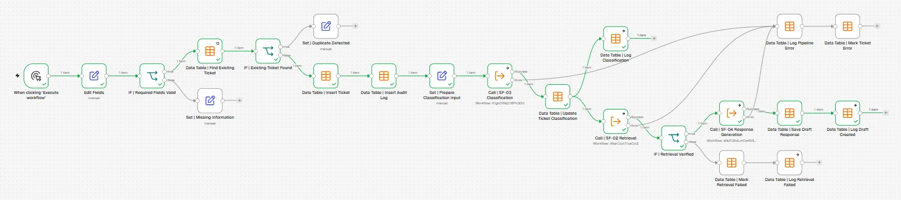
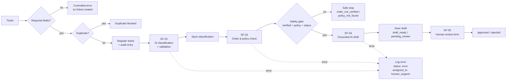
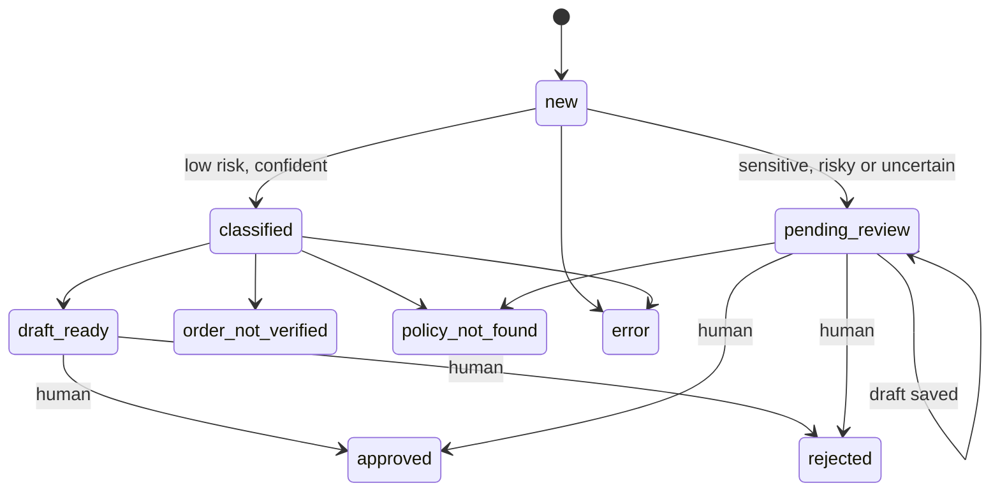
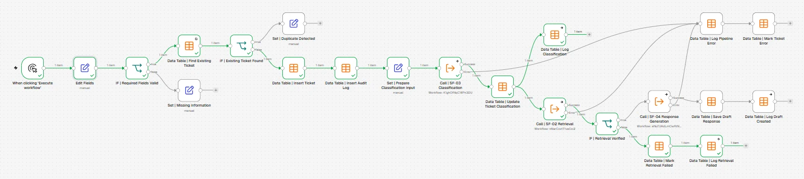
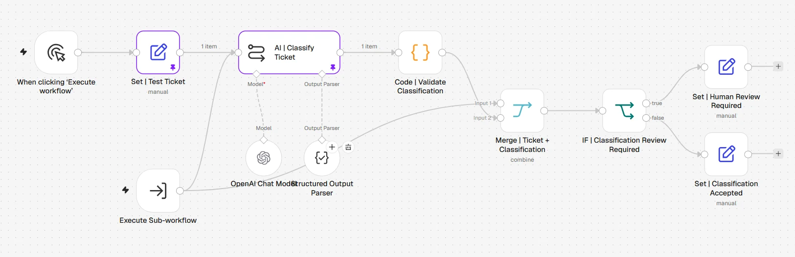
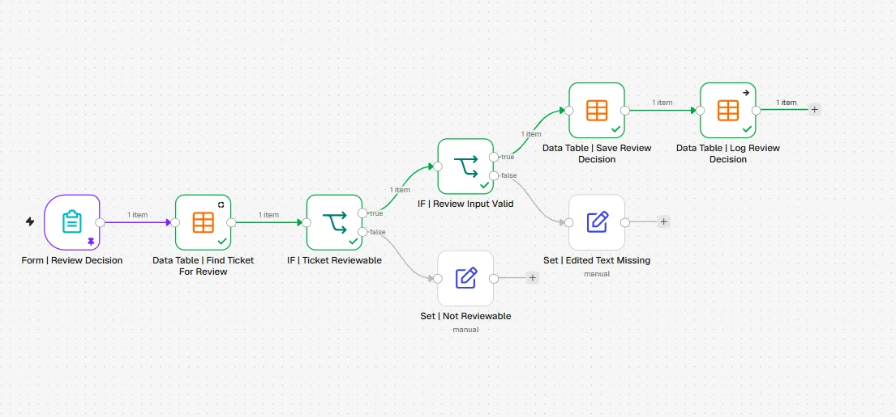
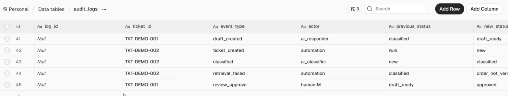

# SupportFlow AI

**An AI customer-support pipeline built in n8n that drafts grounded replies and leaves the final word to a human.**

SupportFlow AI takes a support ticket for a fictional online shop (NordCart), classifies it with an LLM, verifies the order against the customer's email, looks up the matching company policy, and drafts a reply that may only use those verified facts. A person then approves, edits or rejects the draft. Every step is logged, every failure ends in a clear status, and nothing is ever sent to a customer automatically.

**Live demo:** [SupportFlow AI Demo](https://claude.ai/artifact/1veWbjB8r5teSGNbnfqjjL). An interactive replay of real executions, available in English, German and Persian.

---

## What it demonstrates

- **Grounded AI output.** The drafting prompt receives only verified order data and the active policy. It may not invent dates, tracking numbers, refunds or promises.
- **Safety gates.** Input validation, a duplicate check, order verification by order ID *and* email, and a three-condition gate before any draft is written.
- **Human in the loop.** Every draft is reviewed in a form (approve, approve with edits, or reject). A ticket can't be approved twice.
- **Error handling.** Retries for transient AI errors, error outputs on every sub-workflow call, and a global error workflow.
- **Audit trail.** Each step is logged with its time, actor (automation, AI or human) and status change.

## Architecture

Six workflows share four n8n Data Tables. `SF-01` orchestrates the other stages as sub-workflows.

| Workflow | Role |
|---|---|
| `SF-01 \| Ticket Intake & Registration` | Validation, duplicate check, orchestration, persistence, logging |
| `SF-02 \| Order & Policy Retrieval` | Verifies the order by ID + email, fetches the active policy for the category |
| `SF-03 \| AI Ticket Classification` | LLM chain with structured output parser, then code that validates the result and flags human review |
| `SF-04 \| AI Response Generation` | LLM chain that drafts a reply from verified data only |
| `SF-05 \| Human Review` | Form trigger: approve, approve with edits, or reject |
| `SF-99 \| Error Handler` | Error Trigger that logs any uncaught workflow failure |

## Ticket status lifecycle

`approved` means *approved by a human*. It doesn't mean *sent*. Sending is out of scope by design.

## Key design decisions

1. **Classification is saved before retrieval.** If the order lookup fails, the AI's work isn't lost.
2. **An order is verified by order ID and email together.** Someone who knows another customer's order number gets no information and no draft.
3. **A three-condition gate before drafting.** `retrieval_status = verified`, `policy_content` not empty, `order_status` not empty. The LLM never writes without facts.
4. **Validation code after the LLM.** Invalid values, sensitive categories (returns, cancellation), non-low risk, confidence below 0.8, or category `other` all route the ticket to human review.
5. **Prompt rules come from test findings.** After the first refund draft offered an exchange that the policy doesn't mention, a rule was added: no options, alternatives or requirements unless the policy states them. See "What testing changed" below.
6. **Draft and final text are stored separately.** `draft_response` keeps what the AI wrote; `final_response` keeps what a human approved. An internal `DRAFT` label is stripped only on approval.
7. **Durable approval instead of a paused execution.** Review state lives in the ticket row, so a reviewer can act hours later and nothing is lost if an execution stops.
8. **Logging runs on side branches with "continue on error".** An audit insert can't change the data flowing to the next stage or block the ticket.
9. **One shared error branch.** All three sub-workflow calls route errors to the same two nodes. `$prevNode.name` records which stage failed.

## Test results

All tests were run against the fictional seed data in [`data/`](data/).

| Scenario | Ticket | Outcome | Execution |
|---|---|---|---|
| Delivery question | TKT-DEMO-001 | `draft_ready` → approved by a human | SF-01 #141, SF-05 #149 |
| Refund request | TKT-RETURN-TEST-001 | `pending_review` → **rejected** (draft offered an exchange not in the policy) | SF-01 #102, SF-05 #140 |
| Refund request after prompt fix | TKT-RETURN-TEST-002 | `pending_review` → approved, DRAFT label stripped | SF-01 #106, SF-05 #139 |
| Wrong customer email | TKT-DEMO-002 | `order_not_verified`, no draft | SF-01 #145 |
| No matching policy | TKT-FAIL-TEST-005 | `policy_not_found`, no draft | SF-01 #111 |
| AI service failure (injected invalid model ID) | TKT-ERROR-TEST-001 | `error`, assigned to `human_support` | SF-01 #114 |
| Classification failure (injected) | TKT-ERROR-TEST-002 | `error`, failing stage recorded | SF-01 #118 |
| Duplicate ticket | TKT-FAIL-TEST-004 | blocked, existing ticket returned | SF-01 #110 |
| Missing required field | — | controlled error, no ticket created | — |
| Reviewer edits the draft | TKT-NEW-TEST-004 | edited text stored as final, AI draft kept | SF-05 #138 |
| Second approval of the same ticket | TKT-AUDIT-TEST-001 | blocked by the review guard | — |
| Global error workflow | — | logged with n8n's sample error event | — |

## What testing changed

- An IF condition used `is equal to "is not empty"` instead of the `is not empty` operator, so the gate was always closed. It was fixed and a third condition was added.
- After nodes were reordered, five sub-workflow inputs still pointed at `$json` from the wrong node. They now reference `Call | SF-03 Classification` explicitly.
- The first drafts asked customers again for their order number and promised "I will follow up". Prompt rules now forbid both.
- A refund draft offered an exchange and asked for photos. The human reviewer rejected it, and a prompt rule now limits options to what the policy states.
- A new save node first overwrote the classification fields. Checking *all* fields of the test output (not just the new one) caught the regression.

## Known limits

- Processes one ticket per run. Expressions use `.first()`, so batch processing would need item pairing.
- The global error workflow only fires for production triggers, so it was verified with n8n's sample error event.
- The error branch on the order-lookup call is wired but was not fault-tested.
- Intake uses a manual trigger with a sample ticket. A form or webhook trigger would be the next step for real traffic.

## Run it yourself

1. Use n8n 1.113 or newer (Data Tables are required).
2. Create the four Data Tables from [`data/SCHEMA.md`](data/SCHEMA.md), then import `orders.csv` and `knowledge_base.csv`.
3. Import the workflows in this order: `sf-02`, `sf-03`, `sf-04`, `sf-05`, `sf-99`, then `sf-01`.
4. In each Data Table node, re-select your tables. In `SF-01`, re-select the three sub-workflows in the Call nodes.
5. Add an OpenAI credential to the two OpenAI Chat Model nodes (the runs used `gpt-5-mini`).
6. In the settings of SF-01 to SF-04, set **Error Workflow** to `SF-99 | Error Handler`.
7. Edit the sample ticket in `SF-01 → Edit Fields` and click **Execute workflow**. Review drafts through the `SF-05` form.

Notes on the exported files: pinned test data was removed, `meta.instanceId` was stripped, and two IF nodes in SF-02 were renamed for clarity (`IF | Order Verified`, `IF | Policy Found`). No credentials are included.

## Screenshots

| | |
|---|---|
|  |  |
| The orchestrator when the email doesn't match the order | The classification sub-workflow |
|  |  |
| Human review after an approval | Audit log rows from the demo runs |

## Tech stack

n8n Cloud, n8n Data Tables, OpenAI (`gpt-5-mini`) via the n8n LangChain nodes, n8n Form Trigger, JavaScript Code node.

## Author

**Mahnaz Jaldi**: [LinkedIn](https://www.linkedin.com/in/mahnaz-jaldi/) · [Website](https://mahnazjaldi.notion.site/Mahnaz-Jaldi-77ff844ba67e821280a081ac5ebe2a8e) · [GitHub](https://github.com/mahnaz-jaldi)

All customers, orders and policies in this project are fictional.
